  

  <a href="https://arjun-sivasankar.github.io/"><b>Portfolio</b></a> ·
  <a href="https://arjun-sivasankar.github.io/assets/cv/Arjun_Sivasankar_CV.pdf"><b>CV (PDF)</b></a> ·
  <a href="https://www.linkedin.com/in/arjun-sivasankar-381380155/"><b>LinkedIn</b></a> ·
  <a href="mailto:arjun.sivasankar@gmail.com"><b>Email</b></a>

I'm an **AI Engineer and Data Scientist** who builds agents, retrieval and speech systems that run on hardware the team controls. Most recently, at Docs4D, a healthcare AI start-up with four engineers, I owned most of the AI work: patient data could not leave our infrastructure, so the models were fine-tuned, served and evaluated in-house.

Before that I built LLM agents with enterprise customers at Vodafone, co-authored an IEEE paper at TU Dresden, and started out as a mechanical engineer. M.Sc. in Computational Modeling and Simulation, TU Dresden.

## What I built at Docs4D

The code is company property, so it isn't here. The portfolio has the system diagrams and a short film.

| Product | What it did | How |
| --- | --- | --- |
| **SuperDoc** | Conversational clinical assistant for patients, chat and real-time voice, piloted with a German university hospital | LangGraph multi-agent system, RAG over ESC guidelines with citations, MCP tools, a rule-based validation layer for EU MDR; voice loop of about 1.5 s |
| **Private LLM + RAG** | The model and retrieval behind it | Qwen3-30B-A3B fine-tuned with LoRA, served with vLLM on in-house NVIDIA GPUs; Qdrant hybrid search with a batched cross-encoder reranker, retrieval under 1 s |
| **MedScribe** | Live clinical transcription | Streaming NVIDIA Parakeet for live text, Whisper correction and speaker diarization in the background, per-clinic data isolation |
| **DocScan, Frontline** | OCR intake and the clinician dashboard | PaddleOCR-VL service; Next.js, TypeScript and React on Supabase with row-level security |

## Selected public work

<table>
<tr>
<td width="50%" valign="top">

### [Diagnosis prediction with knowledge graphs](https://github.com/Arjun-Sivasankar/MasterThesis)
Master's thesis, ScaDS.AI, TU Dresden (grade 1.3). ICD-9 coding on MIMIC-IV with LoRA-tuned Llama models and UMLS knowledge-graph paths. Graph paths lifted micro-F1 from **0.459 to 0.503** and rare-code F1 by **26 to 46%**. Trained with PyTorch DDP on 3 H100s under SLURM.

`LLMs` `LoRA` `Knowledge graphs` `PyTorch DDP`

</td>
<td width="50%" valign="top">

### [Access interval prediction](https://github.com/Arjun-Sivasankar/AIP)
Code behind my **IEEE ACDSA 2024** paper ([DOI](https://doi.org/10.1109/ACDSA59508.2024.10467779)): neural predictors of memory-access intervals in hardware accelerators, tuned with Optuna.

`Time series` `Keras` `TensorFlow` `Optuna`

</td>
</tr>
<tr>
<td width="50%" valign="top">

### [VoiceAgent](https://github.com/Arjun-Sivasankar/VoiceAgent)
Low-latency speech-to-speech voice agent with a browser HUD, a local action bridge and reproducible TTS benchmarks across CPU and CUDA.

`Speech` `STT/TTS` `Streaming` `Benchmarking`

</td>
<td width="50%" valign="top">

### [Cardiometabolic agents](https://github.com/Arjun-Sivasankar/CardioMetabolic-Agents)
Multi-agent medical consultation prototype in LangGraph for cardiology, diabetes and hypertension: a router, domain specialists and consensus building, with a Streamlit UI.

`Agents` `LangGraph` `RAG` `Streamlit`

</td>
</tr>
<tr>
<td width="50%" valign="top">

### [90% fewer sensors with invertible networks](https://github.com/Arjun-Sivasankar/INN-Sensor-Reduction)
Reconstructing conductivity maps of a hydrogen electrolyzer from magnetic-field sensors with invertible neural networks. k-means kept **10 of 100 sensors** at about 1.5% higher loss.

`Inverse problems` `Generative models` `FrEIA`

</td>
<td width="50%" valign="top">

### [AI fitness coach](https://github.com/Arjun-Sivasankar/AI-Enabled-Fitness-App)
Counts exercise repetitions from a webcam with pose estimation and gives form feedback, in a Streamlit app.

`Computer vision` `MediaPipe` `OpenCV`

</td>
</tr>
</table>

## Stack

  

<table>
<tr>
<td width="33%" valign="top"><b>LLMs and agents</b>  LangGraph, MCP tool calling Multi-agent systems LoRA fine-tuning (PEFT, Unsloth) RAG: Qdrant hybrid search, reranking Azure OpenAI, Claude API</td>
<td width="33%" valign="top"><b>Serving and evaluation</b>  vLLM, SGLang on NVIDIA GPUs Docker, Kubernetes, Terraform GitLab CI, GitHub Actions RAGAS, LLM-as-judge, A/B tests Langfuse, MLflow, W&amp;B</td>
<td width="33%" valign="top"><b>Speech and documents</b>  NVIDIA Parakeet, NeMo, Whisper Speaker diarization Qwen3-TTS, CosyVoice 2 PaddleOCR-VL Azure AI Document Intelligence</td>
</tr>
<tr>
<td width="33%" valign="top"><b>Data science</b>  Python, SQL, pandas, NumPy scikit-learn, XGBoost, LightGBM statsmodels, Optuna Time-series forecasting Design of experiments</td>
<td width="33%" valign="top"><b>Product engineering</b>  FastAPI, async Python, pytest TypeScript, React, Next.js PostgreSQL, Supabase (RLS), Redis</td>
<td width="33%" valign="top"><b>Regulated software</b>  ISO 14971, IEC 62304, ISO 13485 EU MDR, EU AI Act, GDPR</td>
</tr>
</table>

## Also

- **IEEE ACDSA 2024**: Friedrich, Sivasankar, Matúš, Fettweis. *Enlarging the time budget for neural network based predictors for access interval prediction.* [DOI](https://doi.org/10.1109/ACDSA59508.2024.10467779)
- **Indian patent, granted 2024**: a canister-aided gas ejection system, from the sounding rocket I helped lead at Team thrustMIT (Spaceport America Cup 2019).
- **Thesis report**: [MT-Report](https://github.com/Arjun-Sivasankar/MT-Report), the LaTeX source of the Master's thesis.

  
  
  

