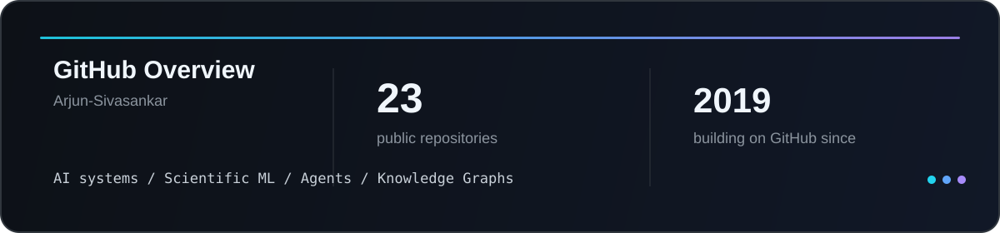

<p align="center">
  
</p>

<p align="center">
  <a href="https://arjun-sivasankar.github.io/"><b>Portfolio</b></a> ·
  <a href="https://www.linkedin.com/in/arjun-sivasankar-381380155/"><b>LinkedIn</b></a> ·
  <a href="mailto:arjun.sivasankar@gmail.com"><b>Email</b></a>
</p>

---

<p align="center">
  
</p>

I am an **AI Engineer** building agentic, retrieval and speech systems that have to run inside the building. In healthcare AI the data cannot leave the infrastructure, so the interesting constraints arrive together: fine-tuned open-weight models served on your own GPUs, retrieval that has to be fast and auditable, and speech that has to keep up with a conversation in real time.

I started as a mechanical engineer and moved into computational modelling, then into production AI. That path still shows in how I work. Most of the problems I like look like engineering problems with a model in the middle: imperfect data, a system that is too complex for one model call, and a result that only counts if it survives contact with reality.

```python
arjun = {
    "focus": ["agentic systems", "RAG", "real-time speech"],
    "recent": ["LoRA fine-tuning", "vLLM serving", "multi-agent orchestration"],
    "measuring": ["RAGAS", "LLM-as-judge", "tracing", "A/B tests"],
    "origin": ["mechanical engineering", "scientific computing", "inverse problems"],
}
```

---

## Selected Work

<table>
<tr>
<td width="50%" valign="top">

### Medical AI and Knowledge Graphs
**[MasterThesis](https://github.com/Arjun-Sivasankar/MasterThesis)**

Multimodal diagnosis prediction from electronic health records on **MIMIC-IV**, combining a UMLS knowledge graph with neuro-symbolic reasoning and LoRA-fine-tuned open-weight LLMs.

`LLMs` `Knowledge Graphs` `MIMIC-IV` `PyTorch`

</td>
<td width="50%" valign="top">

### Agentic Systems
**[MA-CDH](https://github.com/Arjun-Sivasankar/MA-CDH)**

Multi-agent medical consultation system in **LangGraph**, with a router, domain specialists, consensus building and tool access to guidelines, literature and drug interactions.

`Agents` `LangGraph` `RAG` `Medical AI`

</td>
</tr>
<tr>
<td width="50%" valign="top">

### Real-time Speech
**[VoiceAgent](https://github.com/Arjun-Sivasankar/VoiceAgent)**

Low-latency **speech-to-speech** pipeline with a browser HUD, a local action bridge and a configurable voice, plus reproducible **TTS benchmarks** across CPU and CUDA runtimes.

`Speech` `STT/TTS` `Streaming` `Benchmarking`

</td>
<td width="50%" valign="top">

### Scientific Machine Learning
**[Conductivity Reconstruction](https://github.com/Arjun-Sivasankar/Conductivity-Reconstruction-using-Invertible-Neural-Networks-after-sensor-reduction)**

Reconstructing high-resolution conductivity fields from reduced sensor data with **invertible neural networks**, while choosing which sensors to keep.

`Scientific ML` `Inverse Problems` `Generative Models`

</td>
</tr>
<tr>
<td width="50%" valign="top">

### Graphics and Games
**[Nightfall Ward](https://github.com/Arjun-Sivasankar/Nightfall-Ward)**

First-person survival shooter in the browser, built with **TypeScript, Vite and Three.js** as a study in real-time rendering, collision and game feel.

`TypeScript` `Three.js` `Real-time`

</td>
<td width="50%" valign="top">

### Computer Vision
**[GTSRB Traffic Classification](https://github.com/Arjun-Sivasankar/GTSRB-TrafficClassification)**

Convolutional networks for German traffic-sign recognition, and a study of where they fail.

`Computer Vision` `Deep Learning` `Classification`

</td>
</tr>
</table>

---

## Technical Stack

<p align="center">
  
</p>

<table>
<tr>
<td width="33%" valign="top"><strong>LLMs &amp; GenAI</strong><br><br>LoRA fine-tuning<br>Retrieval-augmented generation<br>Hybrid search and reranking<br>Multi-agent systems<br>LangGraph, MCP<br>Prompt engineering</td>
<td width="33%" valign="top"><strong>Deployment</strong><br><br>vLLM, SGLang<br>NVIDIA GPUs, on-premise inference<br>Docker, Kubernetes, Terraform<br>GitLab CI, GitHub Actions<br>AWS, Microsoft Azure<br>MLflow, Langfuse</td>
<td width="33%" valign="top"><strong>Full-Stack</strong><br><br>Python<br>TypeScript, React, Next.js<br>REST APIs, microservices<br>PostgreSQL, Supabase, Redis<br>Async Python, pytest</td>
</tr>
<tr>
<td width="33%" valign="top"><strong>Speech &amp; Document AI</strong><br><br>Whisper, NVIDIA Parakeet<br>Speaker diarization<br>Text-to-speech<br>OCR document processing</td>
<td width="33%" valign="top"><strong>ML &amp; Deep Learning</strong><br><br>PyTorch, TensorFlow<br>scikit-learn<br>Time-series forecasting<br>Quantization-aware training</td>
<td width="33%" valign="top"><strong>Scientific Computing</strong><br><br>NumPy, pandas, SciPy<br>Statistical modelling<br>Design of experiments<br>MATLAB, Simulink, COMSOL</td>
</tr>
</table>

---

## How I work

```text
01  understand the system before touching the model
02  find the structure that actually matters
03  build the smallest experiment that can be wrong
04  measure what happened, not what you hoped
05  put it in front of a user, then keep measuring
```

Evaluation is not the last step. On agentic and speech systems the only honest measure of quality is whether the thing holds up on the messy inputs, so I build the harness early: traced runs, judged outputs, and a baseline I can beat.

---

## GitHub Activity

<a href="https://github.com/Arjun-Sivasankar">
  
</a>

<p align="center">
  <a href="https://github.com/Arjun-Sivasankar?tab=repositories">Repositories</a> ·
  <a href="https://github.com/Arjun-Sivasankar?tab=overview">Contribution activity</a>
</p>

---

## Contact

I am always glad to talk about agentic systems, retrieval, real-time speech, evaluation, and machine learning that has to work under a real constraint.

<p align="center">
  <a href="https://www.linkedin.com/in/arjun-sivasankar-381380155/"></a>
  <a href="https://arjun-sivasankar.github.io/"></a>
  <a href="mailto:arjun.sivasankar@gmail.com"></a>
</p>
